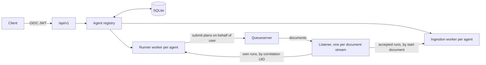

# Bluesky Adaptive server: MVP plan

Status: design notes, not implemented. Tracking issue: [#79](https://github.com/bluesky/bluesky-adaptive/issues/79).

A single-agent prototype (`bluesky_adaptive.rest`, installed with the `server` extra) serves one
`QueueserverAgent` over FastAPI. The MVP below replaces it.

## Goal

bluesky-adaptive provides everything needed to build a beamline alignment server except the scientific and
machine-learning choices. An application developer supplies catalogs of optimizers, evaluation functions and
ingestion functions. Clients (GUIs, scripts, AI agents) compose complete optimization problems from those catalogs
and from the plans and devices the beamline allows, without injecting code. A single-agent deployment is the same
server with one entry in each catalog.

## Principles

- Built on the protocols in `bluesky_adaptive.protocols`; the server has no backend-specific behavior. Optional
  capabilities are detected per agent and enable the matching endpoints.
- Evaluation and ingestion functions own data loading. The server makes no assumptions about how data is read. It
  validates what the protocols already define, plus cheap checks that catalog entries opt into.
- An agent is immutable once created, except for the data it collects and its DOF bounds.
- Hardware access goes through the queueserver. The server never owns a RunEngine or devices. Plan permissions,
  device permissions and value limits are enforced by bluesky-httpserver plan contracts, not duplicated here.
- One server process per storage directory.

## Roles

| Role | Decides | Form |
| ---------------------- | ----------------------------------------------------------------------------- | ------------------------------------------ |
| bluesky-adaptive | Agent lifecycle, runner, endpoints, storage, auth, concurrency, restore | `server` extra |
| Application developer | Optimizer, evaluation and ingestion catalog entries | Python: Pydantic models and build functions |
| Deployment | Queueservers, document streams, storage directory, OIDC settings | Config file; secrets in environment |
| bluesky-httpserver | Allowed plans and devices per user, plan contracts, value limits | Its own configuration |
| Client | Each agent's problem and catalog choices; runs, context, ingestion | JSON over the API |

## Architecture



- One listener per document stream. It routes each run by correlation UID to the agent that submitted it, and offers
  every other run to ingestion subscriptions. Runs nobody claims are ignored.
- The listener only routes. Evaluation and ingestion run on per-agent worker threads, so a slow agent never blocks
  document delivery for the others.
- Every optimizer call (runner, API, ingestion) holds that agent's optimizer lock.

## Application developer interface

```python
from bluesky_adaptive.server import EvaluationEntry, IngestionEntry, OptimizerEntry, ServerSettings, create_app

app = create_app(
    ServerSettings.from_file("server.yml"),
    optimizers=[
        OptimizerEntry("bo-default", version="1", options=BOOptions, build=build_bo, restore=restore_bo),
    ],
    evaluations=[
        EvaluationEntry(
            "image-stats",
            version="1",
            params=ImageStatsParams,
            build=ImageStats,
            outputs=lambda params: {"fwhm", "intensity"},
        ),
    ],
    ingestions=[
        IngestionEntry("alignment-scans", version="1", params=ScanParams, accepts=is_alignment_scan, build=ScanReader),
    ],
)
# uvicorn beamline_app:app
```

| Entry | Required | Optional |
| ----------------- | -------------------------------------------------------------------------------------------------------------------------------------------------------------- | ------------------------- |
| `OptimizerEntry` | `name`, `version`, options model, `build(problem, options, checkpoint_path)` returning an `Optimizer` that is also `Checkpointable`, `restore(checkpoint_path)` | |
| `EvaluationEntry` | `name`, `version`, params model, `build(problem, params)` returning an `EvaluationFunction[str]` | `outputs(params)` |
| `IngestionEntry` | `name`, `version`, params model, `accepts(start_doc) -> bool`, `build(problem, params)` returning a function from run UID to points | `outputs(params)` |

- `build` raising `ValueError` rejects the agent with 422. This is the application's validation hook.
- `version` pins behavior. An agent records the versions of its entries; if a version differs at startup, the agent
  becomes `unavailable` (read-only).
- bluesky-adaptive may ship optimizer entries for its built-in backends.
- There is no plan catalog. The plans a client can choose, and their contracts, come from bluesky-httpserver. Until
  its rewrite lands: the queueserver's allowed plans.

## Agent spec

```json
{
  "queueserver": "bl7",
  "dofs": [
    {"actuator": "kbv_pitch", "type": "range", "bounds": [-1.0, 1.0], "value_type": "float"},
    {"actuator": "filter", "type": "choice", "values": ["none", "Al", "Si"], "value_type": "str"}
  ],
  "objectives": [{"name": "fwhm", "minimize": true}],
  "dof_constraints": [],
  "outcome_constraints": ["intensity >= 1e4"],
  "sensors": ["det"],
  "acquisition_plan": {"name": "default_acquire", "kwargs": {}},
  "evaluation": {"name": "image-stats", "params": {}},
  "optimizer": {"name": "bo-default", "options": {}},
  "ingestion": {"name": "alignment-scans", "params": {}}
}
```

- The problem schema is backend-neutral and owned by the server module.
- Constraints are expressions over DOF and outcome names. An optimizer entry's `build` rejects what its backend
  cannot express.
- `ingestion` is optional.

## Mutability and lifecycle

| Part of an agent | After creation |
| ---------------------------------------------------------------------------------------- | ----------------------------------------------------- |
| DOFs, objectives, constraints, sensors, plan and kwargs, evaluation, optimizer, ingestion | Immutable |
| Collected data | Append only |
| DOF bounds | Changeable while idle; every change recorded |
| Context | Given per run or per suggestion; not agent state |
| Ingestion subscription | Started and stopped as operations |

Run states: `idle`, `running`, `stopping`, `completed`, `stopped`, `failed`, `interrupted` (server restarted during
the run). Agent availability: `available`, `unavailable` (catalog entry version changed).

## Endpoints

All under `/api/v1`.

| Endpoint | Purpose |
| ----------------------------------------------------------------- | ------------------------------------------------------------------------ |
| `GET /catalog/optimizers`, `/catalog/evaluations`, `/catalog/ingestions` | Entry names, versions, JSON Schema of options and params |
| `GET /queueservers`, `/queueservers/{name}/plans`, `/queueservers/{name}/devices` | Allowed plans and devices for the requesting user |
| `POST /agents`, `GET /agents`, `GET /agents/{id}`, `DELETE /agents/{id}` | Create, list, inspect (including status), delete while idle |
| `POST /agents/{id}/run` | Suggest, acquire, evaluate, ingest for N iterations; takes initial context |
| `POST /agents/{id}/submit-suggestions` | Acquire given points |
| `POST /agents/{id}/stop` | Submit nothing more; finishes after the in-flight acquisition is ingested |
| `POST /agents/{id}/suggest` | Suggest without acquiring; takes context |
| `POST /agents/{id}/ingest` | Add externally measured points |
| `POST /agents/{id}/bounds` | Change DOF bounds while idle |
| `GET /agents/{id}/best-points`, `/agents/{id}/history` | Best points; per-iteration suggestions, outcomes and context |
| `POST /agents/{id}/ingestion/subscribe`, `/unsubscribe` | Ingest live runs accepted by the agent's ingestion entry |
| `POST /agents/{id}/ingestion/jobs` | Ingest a given list of past run UIDs |
| `GET /agents/{id}/ingestion` | Subscription state, backlog, per-run results |

Roles from a configurable token claim: `read` (GET), `operate` (run, stop, suggest, ingest, bounds, ingestion),
`admin` (create, delete). `stop` never requires more than `operate`.

## Contextual suggestions

A capability protocol for optimizers that can suggest given the current context.

- A separate method name, not a new argument to `suggest`: `runtime_checkable` protocols only check that a method
  exists, so an added argument could not be detected.
- `POST /run` takes the initial context. After each acquisition the runner derives the next context, records the
  context used for every iteration in the history, and passes it to the next suggestion.
- `POST /suggest` takes a context, so clients can ask for plan inputs on demand.
- Batches of more than one point may be reordered by the acquisition plan (`default_acquire` routes them for
  efficient motion). Agents that plan ordered actions use `n_points=1` or a plan that keeps the order.

Open: the context type.

| Option | Runner can update it itself | Couples protocol to Bluesky runs |
| ---------------------------------------------------------------------- | --------------------------- | -------------------------------- |
| Generic type parameter; backend supplies how the next context is derived | No | No |
| Bluesky-specific, e.g. run UIDs describing the current state plus values held fixed | Yes | Yes |

Open: which run is "current" when agents interleave on one queueserver: the agent's own last acquisition, or the
latest run on that queueserver.

## Passive ingestion

Background learning from runs the agent did not submit, independent of `/run`.

- An `IngestionEntry` defines what an agent learns from. `accepts(start_doc)` is a cheap check on the start document
  before any data is loaded. The built function turns a run UID into points (parameter values and outcomes, no
  `"_id"`), or an empty list if the run does not fit. Data loading is the developer's.
- Points go to `Optimizer.ingest`, which already accepts points without `"_id"`.
- Subscriptions take live runs from the document stream. Jobs take explicit run UIDs, for backfill.
- Runs with this agent's own correlation UID are skipped; the runner already ingests them. Other agents' runs are
  ingested if accepted.
- Each run UID is ingested at most once per agent (`ingested_runs` table), across restarts and overlapping jobs.
- Ingestion runs alongside `/run` under the optimizer lock.
- Runs that happen while the server is down are missed by the subscription; a job recovers them.
- Points must contain every DOF. When outputs are declared, keys other than DOFs must be declared outputs.

## Multiple agents on one queueserver

Allowed. Agents interleave on the queue, which keeps the beam in use while another agent computes its next
suggestion. Interleaving is safe when everything that affects an agent's outcome is either set by its own plan on
every acquisition or left alone by the other agents. Software cannot verify this; the history records interleaving so
it can be checked afterwards.

## Storage and restart

SQLite in the storage directory; a lock file ensures one server process.

| Table | Contents |
| ---------------- | --------------------------------------------------------------------------- |
| `agents` | Spec, catalog entry versions, owner, availability, checkpoint path |
| `operations` | Kind, requested by, timestamps, state, result or error |
| `iterations` | Operation, iteration, run UID, context, suggestions, outcomes, error |
| `bounds_changes` | Agent, DOF, old and new bounds, requested by, time |
| `ingested_runs` | Agent, run UID, status, number of points, error |

- The optimizer checkpoints after every iteration and ingestion batch.
- On restart: rebuild each agent from its spec, `restore` its optimizer, re-apply the latest bounds, and mark
  in-progress runs `interrupted`. Runs never resume automatically, because resuming moves hardware.
- Suggestion and outcome values must be JSON-native (numpy integers, booleans and arrays fail serialization).

## Auth

- Incoming: OIDC JWT validated against the issuer's published keys (`iss`, `aud`, `exp`). Identity is `sub`. An
  explicit `auth: none` mode for local use.
- Outgoing: queueserver clients are created by one function, `connect(queueserver, principal)`. The MVP may start with
  the deployment's own credentials there; on-behalf-of plugs in once bluesky-httpserver accepts exchanged tokens.
- The runner submits plans after `/run` has returned, so the delegated credential must last the whole run (refresh
  or re-exchange, stored encrypted). If it cannot be renewed, the run stops with a distinct state.
- Every operation records who requested it.

## Library changes first

In `bluesky_adaptive.queueserver` and `bluesky_adaptive.protocols`:

1. One listener per document stream, routing by correlation UID and offering other runs to ingestion. Today every
   runner reacts to every bluesky-adaptive run: another agent's run fails a running agent and makes an idle one try
   to register failures for its completed suggestions.
1. Hand documents from the listener to per-agent worker threads.
1. The runner calls the existing `_validate_suggestions` and `_validate_outcomes`, as the local plans already do.
1. `stop()` submits nothing more and resolves after the in-flight acquisition is ingested (`stopping` state). In the
   prototype, one more plan was generated, queued and ingested after `stop()` returned.
1. A per-agent optimizer lock shared by the runner, the API and ingestion.
1. An iteration hook so the server can record history.
1. Queue autostart becomes a deployment setting instead of being set whenever a client is created.
1. `close()` to release an agent's listener subscription.
1. Capability protocols for contextual suggestion and for changing DOF bounds (names to be decided), and context
   handling in the runner.

## Validation summary

- At creation: the schema; actuators, sensors and plan allowed for the user (actuators movable, sensors readable);
  objectives and outcome constraints use only declared outputs; every `build` succeeds.
- At runtime: suggestions and outcomes checked as the protocols already define; ingested points checked as above;
  JSON-native values.
- Not checked: how evaluation and ingestion functions find their data. That is the application developer's code and
  tests.

## Deferred

- Marking collected trials failed or abandoned.
- Seeding a new agent from another agent's history.
- An `exclusive` flag that keeps other agents off the queueserver while an agent runs.
- Running until a stopping criterion is met instead of a fixed number of iterations.
- World models: a separate protocol for transition models (ingest transitions, predict next state), versioned models,
  training outside the request path.
- Automatic backfill of runs missed while the server was down.
- Analysis plots and push updates.

## Open questions

1. Context type: generic or Bluesky-specific.
1. Current context when agents interleave: own last run or latest run on the queueserver.
1. Module name: `bluesky_adaptive.server` (matches the extra, reuses the 0.x name) or keep `rest`.
1. Bounds changes: range bounds only, or also choice values.
1. Whether every optimizer entry must be checkpointable (proposed: yes).
1. Credentials for evaluation and ingestion functions to read data: on behalf of the user or a service identity.
1. bluesky-httpserver plan contracts need value limits that reach inside `suggestions`, keyed by actuator name;
   argument types alone cannot bound positions.

## Implementation order

1. Library changes.
1. Server package: catalogs, agent spec, registry, SQLite, endpoints, `auth: none`.
1. Contextual suggestions.
1. Passive ingestion.
1. OIDC validation; on-behalf-of when bluesky-httpserver supports it.
1. Documentation: how to build a server, reference pages.
